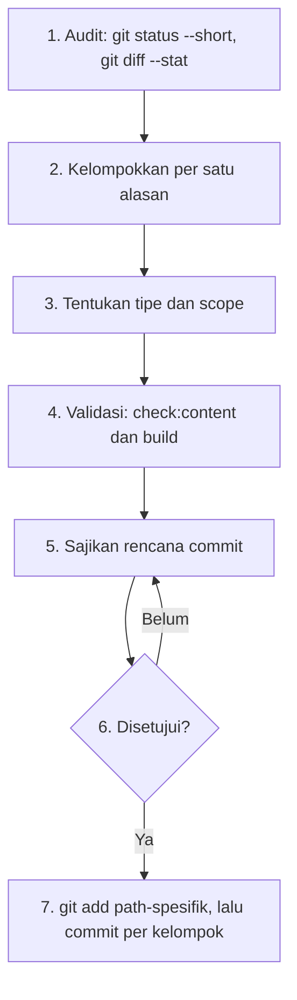

# Conventional Commit

Prosedur commit untuk repository `erp-notes`. Tujuan: riwayat yang dapat dibaca, satu commit satu alasan, dan tidak ada commit yang tidak diminta.

## Aturan Mutlak

> [!CAUTION]
> **Dilarang** menjalankan `git add .`, `git add -A`, atau `git commit` tanpa persetujuan eksplisit pengguna. Selalu sajikan rencana commit lebih dulu.
>
> **Dilarang** menambahkan trailer `Co-Authored-By`, watermark, atau atribusi AI apa pun pada pesan commit.

Aturan tambahan:

- Jangan mencampur perubahan konten dengan perubahan konfigurasi AI dalam satu commit.
- Jangan commit `public/`, `node_modules/`, `.quartz-cache/`, `tsconfig.tsbuildinfo`, `.env`, atau file rahasia.
- Jangan commit file yang belum diperiksa; jalankan validasi lebih dulu.

## Alur



## Langkah 1 — Audit

```bash
git status --short
git diff --stat
git diff --check
```

`git diff --check` menangkap whitespace error sebelum commit.

## Langkah 2 — Kelompokkan

Satu commit = satu alasan yang bisa dijelaskan dalam satu kalimat.

| Boleh digabung | Harus dipisah |
|---|---|
| Artikel + index section-nya | Konten + script validasi |
| Beberapa artikel untuk satu perbaikan yang sama | Perbaikan tautan + migrasi heading |
| Rule + skill yang saling merujuk | Perubahan konten + perubahan CI |
| Script + workflow CI yang memakainya | Commit audit + commit kode |

Jika satu file mengandung dua perubahan yang berbeda, jangan pecah dengan `git add -p`; pilih salah satu kelompok dan sebutkan di body commit.

## Langkah 3 — Format

```text
<type>(<scope>): <subject imperatif, huruf kecil, tanpa titik>
```

- Header dalam bahasa Inggris, konsisten dengan riwayat repository.
- Body opsional dalam Bahasa Indonesia; jelaskan alasan, bukan daftar file.
- Baris header maksimal 72 karakter.

### Tipe

| Tipe | Dipakai untuk |
|---|---|
| `feat` | Kemampuan baru: artikel, skill, script, workflow |
| `fix` | Konten salah, tautan rusak, render rusak |
| `docs` | README, CONTRIBUTING, changelog, laporan audit |
| `refactor` | Restrukturisasi tanpa mengubah makna (heading, pindah aturan) |
| `chore` | Konfigurasi, dependencies, `.gitignore` |
| `test` | Pemeriksaan deterministik dan CI |
| `style` | Whitespace/formatting tanpa perubahan makna |

### Scope

| Scope | Cakupan |
|---|---|
| `fundamentals`, `processes` | `content/00-*`, `content/01-*` |
| `accounting`, `sales`, `purchasing`, `inventory` | `content/02-*` … `content/05-*` |
| `manufacturing`, `finance`, `assets` | `content/06-*` … `content/08-*` |
| `project`, `hr`, `tax` | `content/09-*` … `content/11-*` |
| `software`, `naventra` | `content/20-*`, `content/30-*` |
| `content` | Perubahan lintas section |
| `agents` | `AGENTS.md`, `.agents/` |
| `ci` | `.github/workflows/`, `package.json` |
| `quartz` | `quartz.config.ts`, `quartz.layout.ts` |
| `audit` | `audit/` |

## Langkah 4 — Validasi

Wajib sebelum mengajukan rencana commit yang menyentuh konten:

```bash
npm run check:content
npx quartz build
```

Jika salah satu gagal: perbaiki dulu, jangan commit.

## Langkah 5 — Sajikan Rencana

```markdown
### Rencana Commit

1. `feat(agents): add conventional commit skill`
   - File: `.agents/skills/conventional-commit/SKILL.md`
   - Alasan: prosedur commit yang dapat dipakai ulang.
2. `fix(content): repair broken links`
   - File: `content/07-finance/cash-flow-planning.md`, ...
   - Alasan: 7 tautan menuju halaman 404.
```

Lalu tanyakan: "Apakah rencana commit di atas disetujui?"

## Langkah 6 — Eksekusi

```bash
git add <path-spesifik-1> <path-spesifik-2>
git commit -m "tipe(scope): subjek"

git add <path-kelompok-2>
git commit -m "tipe(scope): subjek"
```

Verifikasi setelah setiap commit:

```bash
git show --stat --oneline HEAD
git status --short
```

## Jika Gagal

| Kondisi | Tindakan |
|---|---|
| Validasi gagal | Perbaiki; jangan commit |
| File tak terduga ikut berubah | Hentikan, tanyakan |
| File rahasia terdeteksi | Jangan commit; laporkan |
| Rencana ditolak | Revisi kelompok, jangan memaksa |
| Commit sudah terlanjur | Laporkan; jangan `reset --hard` tanpa izin |

## Definition of Done

- [ ] Rencana commit disetujui.
- [ ] `npm run check:content` → 0 error.
- [ ] `npx quartz build` berhasil (jika konten berubah).
- [ ] Tidak ada trailer atribusi AI.
- [ ] `git status --short` bersih untuk file yang direncanakan.
