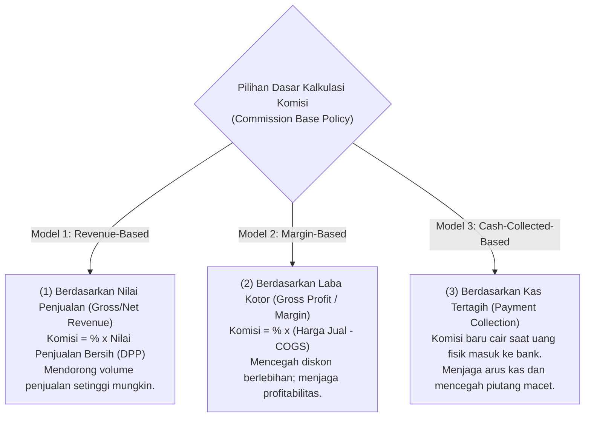
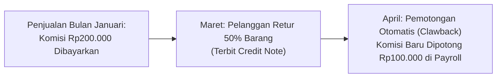

# Sales Commission

## Definition

**Sales Commission (Komisi Penjualan)** dalam sistem ERP adalah modul insentif komersial yang menghitung, melacak, dan mengalokasikan imbalan finansial bagi perwakilan penjualan (*sales representatives*), manajer akun (*account executives*), atau agen perantara berdasarkan pencapaian target volume transaksi, laba kotor, atau efektivitas penerimaan kas.

Dalam arsitektur ERP enterprise, komisi penjualan menghubungkan tiga pilar bisnis: **performa operasional komersial (Sales)**, **disiplin penagihan kas (Accounts Receivable)**, dan **penggajian beban operasional (Payroll & General Ledger)**.

---

## Business Purpose

Implementasi modul komisi penjualan di dalam ERP bertujuan untuk:
1. **Penyelarasan Insentif Penjual dengan Tujuan Perusahaan**: Mengarahkan tenaga penjual agar tidak hanya mengejar omzet (*top-line revenue*), melainkan juga memprioritaskan penjualan produk dengan marjin laba tinggi (*profit margin*) dan pelanggan yang disiplin membayar (*cash collection*).
2. **Otomatisasi dan Transparansi Perhitungan (*Dispute Elimination*)**: Menghilangkan perselisihan hitungan komisi antara bagian komersial dan keuangan melalui aturan matematis yang transparan dan dapat diaudit (*auditable logs*).
3. **Mitigasi Kerugian Pembayaran Komisi di Awal (*Clawback Protection*)**: Mencegah pembayaran komisi atas transaksi yang pada akhirnya dibatalkan, diretur, atau berakhir menjadi piutang macet (*bad debt*).

---

## Model Dasar Perhitungan Komisi (Commission Bases)

Sistem ERP mendukung beberapa formula dasar untuk menghitung nilai komisi:

### 1. Revenue-Based Commission (Berbasis Omzet Penjualan)
* Dihitung dari nilai penjualan bersih sebelum pajak (DPP).
* *Rumus*: $\text{Komisi} = \text{DPP} \times \text{Tarif Komisi}$.
* *Kelemahan*: Tenaga penjual cenderung memberikan diskon maksimal demi mencapai target omzet tanpa mempedulikan marjin laba perusahaan.

### 2. Margin-Based Commission (Berbasis Laba Kotor)
* Dihitung dari selisih antara harga jual dengan Beban Pokok Penjualan (COGS).
* *Rumus*: $\text{Komisi} = (\text{Nilai Penjualan} - \text{COGS}) \times \text{Tarif Komisi}$.
* *Keunggulan*: Mendorong tenaga penjual untuk mempertahankan harga jual tinggi dan menolak pemberian diskon berlebihan.

### 3. Cash-Collected-Based Commission (Berbasis Pelunasan Kas)
* Komisi dihitung berdasarkan faktur yang telah berstatus **Lunas (*Paid / Cleared*)** di modul Accounts Receivable.
* *Prinsip Praktik Terbaik ERP*: Jika pelanggan tidak melunasi tagihan, komisi tidak akan pernah dibayarkan ke staf penjualan. Hal ini memotivasi tim penjualan untuk membantu tim penagihan (*collection team*).

---

## Struktur Rencana Komisi Lanjutan (Advanced Commission Schemes)

1. **Tiered / Accelerated Commission (Komisi Bertingkat / Akselerator)**:
   Meningkatkan persentase komisi jika penjualan melampaui kuota target:
   * Pencapaian $0\% - 100\%$ kuota: Komisi 2%.
   * Pencapaian $101\% - 150\%$ kuota: Komisi 4% (akselerator).
   * Pencapaian $> 150\%$ kuota: Komisi 6%.
2. **Split Commission (Komisi Bagi Hasil Tim)**:
   Jika satu kesepakatan kontrak besar dikerjakan bersama oleh beberapa perwakilan (misal: satu staf teknis *Pre-Sales* dan satu staf komersial *Account Executive*), nilai komisi dapat dialokasikan dengan rasio persentase tertentu (misal: 60% : 40%).

---

## Mekanisme Penarikan Kembali (*Clawback & Adjustments*)

Apa yang terjadi jika komisi telah dibayarkan, namun 2 bulan kemudian pelanggan mengembalikan barangnya (*Sales Return*) atau dinyatakan pailit secara hukum?

> **Prinsip Clawback (Penarikan Kembali Komisi):**
> ERP enterprise secara otomatis memotong (*deduct*) saldo komisi staf penjualan pada periode penggajian berikutnya jika terjadi retur penjualan via [[04-sales/sales-return-and-credit-note|Credit Note]] atau penghapusan piutang tak tertagih (*Bad Debt Write-Off*).

---

## Dampak Akuntansi & Penggajian (Accounting Impact)

> [!important] Komisi adalah Beban Operasional, Bukan Pengurang Pendapatan Langsung
> Beban komisi diklasifikasikan sebagai **Beban Penjualan (*Operating / Selling Expense*)**, bukan pengurang langsung dari akun Pendapatan di Laba Rugi. Namun waktu pengakuannya mengikuti IFRS 15.91: komisi incremental yang dapat dipulihkan dikapitalisasi lebih dulu, bukan langsung dibebankan (lihat subbagian di bawah).

### Skenario Transaksi Acuan:
Staf penjualan "Budi" berhasil menjual 10 unit *Laptop Pro* seharga Rp10.000.000 (DPP) dengan COGS Rp7.000.000. Sesuai kebijakan perusahaan, komisi ditetapkan sebesar **2% dari penjualan bersih** (Rp200.000), yang dibayarkan setelah pelanggan melunasi tagihan.

#### 1. Saat Tagihan Dilunasi Pelanggan: Akrual Komisi Penjualan

| Akun | Kategori | Debit (Rp) | Kredit (Rp) |
|---|---|---:|---:|
| Beban Komisi Penjualan (*Commissions Expense*) | Expense (Laba Rugi) | 200.000 | - |
| Utang Komisi Penjualan (*Commissions Payable*) | Liability (Neraca) | - | 200.000 |

#### 2. Saat Penyetoran Komisi Melalui Siklus Penggajian (*Payroll Settlement*):

| Akun | Kategori | Debit (Rp) | Kredit (Rp) |
|---|---|---:|---:|
| Utang Komisi Penjualan (*Commissions Payable*) | Liability (Neraca) | 200.000 | - |
| Kas / Bank Operasional (Transfer Gaji) | Asset (Neraca) | - | 200.000 |

### Perlakuan IFRS 15.91: Kapitalisasi Biaya Perolehan Kontrak

Komisi penjualan yang hanya timbul jika kontrak diperoleh (*incremental cost of obtaining a contract*) dan diperkirakan dapat dipulihkan **wajib dikapitalisasi** sebagai aset biaya perolehan kontrak, lalu diamortisasi secara sistematis sejalan dengan pengakuan pendapatan (IFRS 15.91–94). Membebankan seluruh komisi pada saat pesanan diterima hanya dibenarkan jika masa manfaat aset tersebut satu tahun atau kurang — praktik yang diizinkan sebagai *practical expedient* (IFRS 15.94).

| Kondisi | Perlakuan |
|---|---|
| Komisi bersifat incremental (tidak akan timbul tanpa kontrak) dan dapat dipulihkan | Kapitalisasi; amortisasi sejalan dengan pendapatan |
| Masa amortisasi ≤ 1 tahun | Boleh langsung dibebankan (*practical expedient*), diungkapkan |
| Komisi tidak incremental (mis. gaji tetap staf penjualan) | Beban saat terjadinya |

**Contoh**: komisi Rp200.000 atas kontrak 12 bulan dikapitalisasi pada 1 Oktober 2026, lalu diamortisasi Rp16.666,67/bulan (Rp200.000 ÷ 12). Jika jurnal dibulatkan ke rupiah penuh, selisih pembulatan disesuaikan pada angsuran terakhir agar total amortisasi tepat Rp200.000.

| Akun | Debit (Rp) | Kredit (Rp) |
|---|---:|---:|
| Aset Biaya Perolehan Kontrak (*Contract Acquisition Cost*) | 200.000 | - |
| Utang Komisi Penjualan (*Commissions Payable*) | - | 200.000 |

Setiap bulan, saat pendapatan diakui:

| Akun | Debit (Rp) | Kredit (Rp) |
|---|---:|---:|
| Beban Komisi Penjualan (*Commissions Expense*) | 16.667 | - |
| Aset Biaya Perolehan Kontrak | - | 16.667 |

*(pembulatan; lihat catatan penyesuaian angsuran terakhir)*

Jika kontrak berakhir lebih cepat atau dihentikan, sisa aset diuji penurunan nilai dan dihapus pada periode tersebut. ERP umumnya menangani ini melalui jadwal amortisasi pada dokumen kontrak, bukan jurnal manual bulanan.

---

## Related Concepts

* [[04-sales/sales-order|Sales Order]] — Penugasan staf penjualan penanggung jawab pesanan.
* [[04-sales/accounts-receivable-integration|Accounts Receivable Integration]] — Pelunasan kas sebagai syarat pencairan komisi.
* [[04-sales/sales-return-and-credit-note|Sales Return and Credit Note]] — Pemicu pemotongan penarikan komisi (*clawback*).
* [[03-accounting/accrual-and-adjusting-entries|Accrual and Adjusting Entries]] — Pengakuan utang akrual komisi akhir periode.

---

## References

- ASCM. *APICS Dictionary*. https://www.ascm.org/ascm-insights/apics-dictionary/ Diakses 26 November 2026.
1. **ERPNext Documentation** — *Sales Person*. https://docs.frappe.io/erpnext/sales-person — diakses 24 November 2026.
2. **ERPNext Documentation** — *How to Give Commission to Sales Partner*. https://docs.frappe.io/erpnext/how-to-give-commission-to-sales-partner — diakses 24 November 2026.
3. **Odoo 20.0 Documentation** — *Sales*. https://www.odoo.com/documentation/20.0/applications/sales/sales.html — diakses 24 November 2026.
